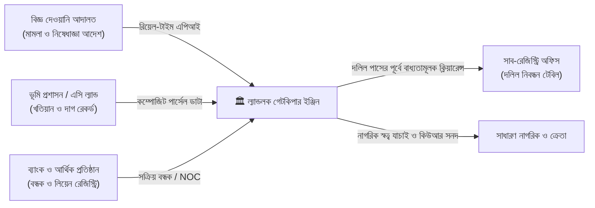
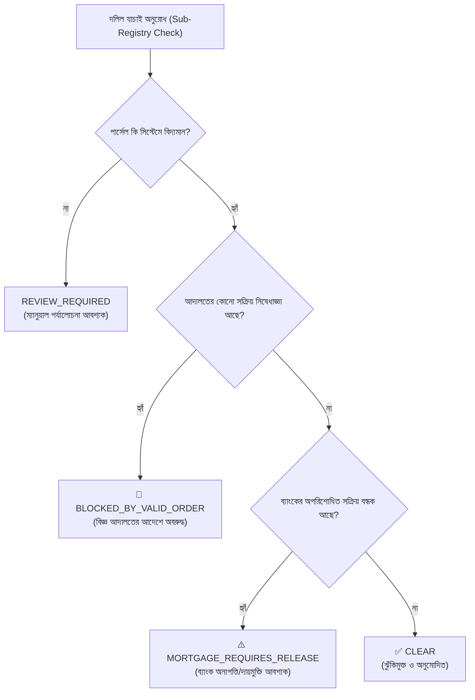

<p align="center">
  
</p>

<h1 align="center">🏛️ ল্যান্ডলক ইঞ্জিন (LandLock Engine)</h1>
<h3 align="center">Automated Land Injunction & Title Encumbrance Central Registry</h3>

<p align="center">
  <strong>নিরাপদ জমি • স্বচ্ছ মালিকানা • ডিজিটাল বাংলাদেশ</strong><br />
  <em>একটি আন্তঃপ্রাতিষ্ঠানিক স্বয়ংক্রিয় ভূমি আইনি-ঝুঁকি ও স্বত্ব যাচাইকরণ গেটকিপার প্ল্যাটফর্ম</em>
</p>

<p align="center">
  
  
  
  
  
  
</p>

---

## 📑 সূচিপত্র (Table of Contents)
- [১. প্রকল্প পরিচিতি (Executive Summary)](#১-প্রকল্প-পরিচিতি-executive-summary)
- [২. পটভূমি ও সমাধানের আবশ্যকতা (Problem Statement)](#২-পটভূমি-ও-সমাধানের-আবশ্যকতা-problem-statement)
- [৩. সিস্টেমের মূল কর্মপ্রবাহ (Core Architecture & Flow)](#৩-সিস্টেমের-মূল-কর্মপ্রবাহ-core-architecture--flow)
- [৪. পাঁচ-স্তরের গেটকিপার সিদ্ধান্ত অ্যালগরিদম (Gatekeeper Decision Engine)](#৪-পাঁচ-স্তরের-গেটকিপার-সিদ্ধান্ত-অ্যালগরিদম-gatekeeper-decision-engine)
- [৫. মূল মডিউলসমূহ ও ফিচার (Key Modules & Features)](#৫-মূল-মডিউলসমূহ-ও-ফিচার-key-modules--features)
- [৬. ভূমিকাভিত্তিক অ্যাক্সেস ও ডেমো অ্যাকাউন্ট (Role-Based Access & Demo Logins)](#৬-ভূমিকাভিত্তিক-অ্যাক্সেস-ও-ডেমো-অ্যাকাউন্ট-role-based-access--demo-logins)
- [৭. লাইভ ডেমো ও শোকেস দৃশ্যকল্প (Step-by-Step Demo Walkthrough)](#৭-লাইভ-ডেমো-ও-শোকেস-দৃশ্যকল্প-step-by-step-demo-walkthrough)
- [৮. প্রযুক্তিগত কাঠামো (Technology Stack)](#৮-প্রযুক্তিগত-কাঠামো-technology-stack)
- [৯. ইন্সটলেশন ও রান করার নিয়ম (Installation & Quick Start)](#৯-ইন্সটলেশন-ও-রান-করার-নিয়ম-installation--quick-start)
- [১০. ডিরেক্টরি কাঠামো (Project Structure)](#১০-ডিরেক্টরি-কাঠামো-project-structure)
- [১১. আইনি কাঠামো ও প্রাসঙ্গিক আইন (Statutory & Legal Framework)](#১১-আইনি-কাঠামো-ও-প্রাসঙ্গিক-আইন-statutory--legal-framework)

---

## ১. প্রকল্প পরিচিতি (Executive Summary)

**ল্যান্ডলক ইঞ্জিন (LandLock Engine)** হলো আদালত, ভূমি প্রশাসন (এসি ল্যান্ড), সাব-রেজিস্ট্রি এবং ব্যাংকসমূহের মধ্যে একটি রিয়েল-টাইম কেন্দ্রীয় সমন্বিত আইনি গেটকিপার প্ল্যাটফর্ম। 

জমির দলিল নিবন্ধনের (Registration) পূর্ব মুহূর্তে জমিতে কোনো **বিজ্ঞ আদালতের সক্রিয় নিষেধাজ্ঞা (Court Injunction/Status Quo)**, **দেওয়ানি মামলা**, অথবা **আর্থিক প্রতিষ্ঠানের অপরিশোধিত বন্ধক (Mortgage/Lien)** রয়েছে কিনা তা স্বয়ংক্রিয়ভাবে যাচাই করে তাৎক্ষণিক **CLEAR** অথবা **BLOCKED** সিদ্ধান্ত প্রদান করাই এই সিস্টেমের মূল লক্ষ্য।



---

## ২. পটভূমি ও সমাধানের আবশ্যকতা (Problem Statement)

বাংলাদেশে জমি সংক্রান্ত বিরোধ ও দেওয়ানি মামলার সংখ্যা লক্ষাধিক। এই সংকটের পেছনে প্রধান ৪টি কারণ বিদ্যমান:

1. **তথ্য আদান-প্রদানে চরম বিলম্ব:** আদালত কোনো জমির ওপর নিষেধাজ্ঞা দিলে সেই কাগজের আদেশ ডাকযোগে বা পিয়ন মারফত ভূমি অফিস বা সাব-রেজিস্ট্রি অফিসে পৌঁছাতে কয়েক সপ্তাহ থেকে কয়েকমাস সময় লেগে যায়। এই সুযোগে জালিয়াত চক্র বিতর্কিত জমি দ্রুত বিক্রি করে দেয়।
2. **ডাবল মর্টগেজ ও প্রতারণামূলক হস্তান্তর:** ব্যাংকে জমি বন্ধক রেখে ঋণ নেওয়ার পর দলিলের নকল বা গোপন রেখে একই জমি সাধারণ নিরীহ ক্রেতার কাছে বিক্রি করে দেওয়া হয়।
3. **একক দাগ নম্বরের অস্পষ্টতা:** একই উপজেলায় একাধিক মৌজায় একই দাগ নম্বর থাকতে পারে। সুনির্দিষ্ট কম্পোজিট আইডেন্টিফায়ার ছাড়া জমি এককভাবে চিহ্নিত করা যায় না।
4. **ক্রেতা সাধারণের অসহায়ত্ব:** জমি কেনার আগে সাধারণ নাগরিকের পক্ষে জানা সম্ভব হয় না যে জমিটিতে আদালতে কোনো মামলা চলছে কি না বা ব্যাংকে দায়বদ্ধ আছে কি না।

> **ল্যান্ডলক সমাধান:** কাগজের আদেশের জন্য অপেক্ষা না করে আদালতের আদেশ অনুমোদনের ভগ্নাংশ সেকেন্ডের মধ্যে কেন্দ্রীয় ডাটাবেজে পার্সেল ব্লক হয়ে যায়। সাব-রেজিস্ট্রারের টেবিলে ল্যান্ডলক ইঞ্জিনের সবুজ সিগন্যাল (`CLEAR`) ছাড়া কোনো দলিল সিস্টেম গ্রহণ করে না।

---

## ৩. সিস্টেমের মূল কর্মপ্রবাহ (Core Architecture & Flow)

### ৩.১ কম্পোজিট পার্সেল আইডেন্টিফায়ার (Composite Land Identifier)
একটি পার্সেলকে নির্ভুলভাবে চিহ্নিত করতে ল্যান্ডলক ৭-স্তরের হায়ারার্কি ব্যবহার করে:
$$\text{Division} \rightarrow \text{District} \rightarrow \text{Upazila} \rightarrow \text{Mouza (JL)} \rightarrow \text{Khatian} \rightarrow \text{Dag (Plot)} \rightarrow \text{Sub-Parcel}$$

*উদাহরণ:* `DHAKA-DHANMONDI-MOUZA01-KH101-DAG5001-PL1`

### ৩.২ টু-পার্টি মেকার-চেকার নিয়ম (Two-Party Separation of Duty)
আইনি আদেশের অপব্যবহার রোধ করতে সিস্টেমে কঠোর নীতি কার্যকর:
* **আদালত পেশকার/ক্লার্ক (`COURT_OFFICER`):** মামলার বিবরণী ও আদেশের খসড়া সিস্টেমে দাখিল (SUBMIT) করতে পারেন, কিন্তু চূড়ান্ত অনুমোদন দিতে পারেন না।
* **বিজ্ঞ বিচারক (`ORDER_APPROVER`):** দাখিলকৃত নথি পর্যালোচনা করে চূড়ান্ত ডিজিটাল অনুমোদন (APPROVE) অথবা প্রত্যাখ্যান (REJECT) করেন।
* **ফলাফল:** বিচারকের অনুমোদনের সাথে সাথে স্বয়ংক্রিয়ভাবে সংশ্লিষ্ট পার্সেল লক হয়ে যায়।

---

## ৪. পাঁচ-স্তরের গেটকিপার সিদ্ধান্ত অ্যালগরিদম (Gatekeeper Decision Engine)

সাব-রেজিস্ট্রার যখন কোনো জমি হস্তান্তরের জন্য যাচাই করেন, সিস্টেম নিচের ক্রমানুসারে স্বয়ংক্রিয় সিদ্ধান্ত গ্রহণ করে:



| সিদ্ধান্ত কোড | আইনি তাৎপর্য | সাব-রেজিস্ট্রারের দাপ্তরিক পদক্ষেপ |
| :--- | :--- | :--- |
| **`BLOCKED_BY_VALID_ORDER`** | আদালতের বৈধ স্থগিতাদেশ/নিষেধাজ্ঞা বলবৎ আছে। | **রেজিস্ট্রি আইনত সম্পূর্ণ নিষিদ্ধ।** সিস্টেম স্বয়ংক্রিয়ভাবে দলিল বাতিল করবে। |
| **`MORTGAGE_REQUIRES_RELEASE`** | আর্থিক প্রতিষ্ঠানের বন্ধক বিদ্যমান এবং বৈধ অনাপত্তি (NOC) দাখিল হয়নি। | রেজিস্ট্রি স্থগিত থাকবে যতক্ষণ না ব্যাংক ডিজিটাল দায়মুক্তি প্রদান করে। |
| **`REVIEW_REQUIRED`** | পার্সেলের তফসিলে অস্পষ্টতা বা সীমানা বিরোধ সংক্রান্ত তথ্য যাচাইাধীন। | এসি ল্যান্ড ও রেকর্ড রুমের সরেজমিন পর্যালোচনা আবশ্যক। |
| **`CLEAR`** | কোনো আইনি নিষেধাজ্ঞা বা অপরিশোধিত বন্ধক নেই। | **দলিল নিবন্ধন প্রক্রিয়া সম্পন্ন করা যাবে।** |

---

## ৫. মূল মডিউলসমূহ ও ফিচার (Key Modules & Features)

### 🏛️ ১. কোর্ট অর্ডার পোর্টাল (`/cases`)
- বিজ্ঞ দেওয়ানি আদালতের মামলা ও আরজি এন্ট্রি।
- স্থগিতাদেশ (Status Quo), অস্থায়ী নিষেধাজ্ঞা (Temporary Injunction) ট্র্যাকিং।
- বিচারিক মেকার-চেকার রিভিউ ও অনুমোদন কনসোল।

### 📋 ২. সাব-রেজিস্ট্রার গেটকিপার কনসোল (`/registry`)
- দলিল নিবন্ধনের পূর্বে তাৎক্ষণিক ঝুঁকি যাচাই।
- দলিলের ধরন অনুযায়ী (বিক্রয়, হেবা, বন্ধক, বণ্টন) স্বয়ংক্রিয় ব্লক/পাস পলিসি।
- আইনানুগ অনাপত্তি সনদ যাচাই ও প্রিন্টযোগ্য অফিসিয়াল প্রত্যয়নপত্র।

### 🏦 ৩. ব্যাংক বন্ধক ও লিয়েন পোর্টাল (`/bank` & `/mortgages`)
- তফসিলি ব্যাংক ও আর্থিক প্রতিষ্ঠানের ঋণের বিপরীতে জমির লিয়েন নিবন্ধন।
- বন্ধক ছাড়পত্র (Release Deed / Mortgage NOC) আপলোড ও রিয়েল-টাইম স্ট্যাটাস আপডেট।
- একই জমিতে ডাবল ঋণ বিতরণ ও গোপন রেজিস্ট্রি প্রতিরোধ।

### 👤 ৪. নাগরিক জমি অনুসন্ধান (`/citizen`)
- জেলা, উপজেলা, মৌজা, খতিয়ান ও দাগ নম্বর দিয়ে সরাসরি জমি অনুসন্ধান।
- কোনো অ্যাকাউন্ট তৈরি ছাড়াই তাৎক্ষণিক আইনি ঝুঁকি ও বন্ধক স্ট্যাটাস প্রদর্শন।
- এক ক্লিকে ডেমো টেস্ট কেস লোড করার সুবিধা।

### 🛡️ ৫. ডিজিটাল অনাপত্তি সনদ ও কিউআর স্ক্যানার (`/verify-certificate`)
- এনক্রিপ্টেড ডিজিটাল সিগনেচার ও ইউনিক ১২-ডিজিটের ট্র্যাকিং কোড সম্বলিত প্রত্যয়নপত্র।
- **বাস্তব স্মার্টফোন ক্যামেরা দিয়ে সরাসরি স্ক্যানযোগ্য লাইভ কিউআর কোড** (কোনো স্পেশাল অ্যাপ ছাড়াই ফোনের ক্যামেরা অন করে স্ক্যান করলেই ভেরিফিকেশন লিংক চালু হয়)।
- ড্র্যাগ-অ্যান্ড-ড্রপ ইমেজ স্ক্যানার ও রিয়েল-টাইম ক্যামেরা স্ক্যানার সাপোর্ট।
- প্রিন্ট ও অফিশিয়াল পিডিএফ ডাউনলোড সুবিধা।

### 🗺️ ৬. মৌজা নকশা ও ক্যাডাস্ট্রাল জিআইএস ভিউয়ার (`/map`)
- Esri World Imagery হাই-রেজোলিউশন স্যাটেলাইট টাইলিং।
- দাগ অনুযায়ী ভেক্টর বাউন্ডারি ও কালার-কোডেড ভিজ্যুয়াল স্ট্যাটাস:
  - 🔴 **লাল সীমানা:** আদালতের আদেশে অবরুদ্ধ।
  - 🟡 **হলুদ সীমানা:** মামলা বা বন্ধক পর্যালোচনাধীন।
  - 🟢 **সবুজ সীমানা:** সম্পূর্ণ দায়মুক্ত ও পরিষ্কার জমি।
- ইন্টারেক্টিভ ক্লিক-টু-ইনস্পেক্ট পপআপ।

### 📊 ৭. অপরিবর্তনীয় সেন্ট্রাল অডিট ট্রেইল (`/audit`)
- প্রতিটি অনুসন্ধান, মামলা এন্ট্রি, আদেশ অনুমোদন ও গেটকিপার সিদ্ধান্তের টাইমস্ট্যাম্পড অডিট ট্রেইল।
- আইপি অ্যাড্রেস, অ্যাকশন মেটাডাটা ও ইউজার রোল ট্র্যাকিং।

---

## ৬. ভূমিকাভিত্তিক অ্যাক্সেস ও ডেমো অ্যাকাউন্ট (Role-Based Access & Demo Logins)

সিস্টেমে ৮ ধরনের ব্যবহারকারী ভূমিকার জন্য প্রি-কনফিগার করা অ্যাকাউন্ট রয়েছে।

> **সকল ডেমো অ্যাকাউন্টের ডিফল্ট পাসওয়ার্ড:** `demo123`

| ব্যবহারকারী নাম (Username) | পদবী ও ভূমিকা (Role) | অনুমোদিত কর্মপরিধি | ড্যাশবোর্ড রুট |
| :--- | :--- | :--- | :--- |
| `court_officer1` | আদালত কর্মকর্তা (COURT_OFFICER) | মামলা দাখিল ও নিষেধাজ্ঞার খসড়া এন্ট্রি | `/cases` |
| `order_approver1` | অনুমোদনকারী বিচারক (ORDER_APPROVER) | বিচারিক আদেশ অনুমোদন ও প্রত্যাহার | `/approvals` |
| `registry_officer1` | সাব-রেজিস্ট্রার (REGISTRY_OFFICER) | দলিল রেজিস্ট্রির পূর্বে গেটকিপার চেক | `/registry` |
| `bank_officer1` | ব্যাংক কর্মকর্তা (BANK_OFFICER) | ঋণের বিপরীতে বন্ধকী লিয়েন ও রিলিজ এনওসি | `/bank` |
| `land_officer1` | সহকারী কমিশনার - ভূমি (LAND_OFFICER) | খতিয়ান, দাগ ও পার্সেল রেকর্ড হালনাগাদ | `/parcels` |
| `auditor1` | সিস্টেম অডিটর (AUDITOR) | নিরীক্ষা লগ ও অডিট ট্রেইল পরিদর্শন | `/audit` |
| `citizen1` | সাধারণ নাগরিক (CITIZEN) | জমি অনুসন্ধান ও জনস্বার্থে তথ্য যাচাই | `/citizen` |
| `admin1` | সিস্টেম প্রশাসক (SYSTEM_ADMIN) | পূর্ণাঙ্গ সিস্টেম মনিটরিং ও কন্ট্রোল | `/dashboard` |

---

## ৭. লাইভ ডেমো ও শোকেস দৃশ্যকল্প (Step-by-Step Demo Walkthrough)

অতিথি ও মূল্যায়নকারীদের সামনে সিস্টেমটি প্রদর্শন করার একটি আদর্শ দৃশ্যকল্প:

1. **নাগরিক অনুসন্ধান:** `/citizen` পেইজে গিয়ে **"ধানমন্ডি দাগ ৫০০১"** সিলেক্ট করুন। 
   - *ফলাফল:* 🛑 **বিজ্ঞ আদালতের আদেশে অবরুদ্ধ** এবং ব্যাংকে বন্ধক বিদ্যমান।
2. **মৌজা স্যাটেলাইট নকশা:** `/map` পেইজে গিয়ে স্যাটেলাইট ভিউতে ধানমন্ডি ৫০০১ দাগের ওপর লাল পলিগন দেখুন এবং ক্লিক করে মামলার বিবরণ ও দাগের সীমানা দেখুন।
3. **সাব-রেজিস্ট্রি গেটকিপার ব্লক:** `/registry` পেইজে যান। ধানমন্ডি দাগ ৫০০১ এবং "বিক্রয় দলিল" নির্বাচন করে যাচাই চাপুন।
   - *ফলাফল:* **`BLOCKED_BY_VALID_ORDER`** — রেজিস্ট্রি স্বয়ংক্রিয়ভাবে বাতিল।
4. **দায়মুক্ত জমি যাচাই:** `/registry` পেইজে "মিরপুর দাগ ৭০০৩" নির্বাচন করুন।
   - *ফলাফল:* **`CLEAR`** — আইনগত কোনো বাধা নেই। ডিজিটাল অনাপত্তি সনদ তৈরি করুন।
5. **স্মার্টফোন কিউআর যাচাই:** `/verify-certificate` পেইজে যান। স্ক্রিনের কিউআর কোডটি আপনার মোবাইলের ক্যামেরা দিয়ে স্ক্যান করুন — সাথে সাথে মোবাইলের ব্রাউজারে সত্যায়িত সার্টিফিকেট ওপেন হবে।
6. **অডিট ট্রেইল:** `/audit` পেইজে গিয়ে প্রতিটি অ্যাকশনের অপরিবর্তনীয় সরকারি রেকর্ড যাচাই করুন।

---

## ৮. প্রযুক্তিগত কাঠামো (Technology Stack)

```
                            ল্যান্ডলক ইঞ্জিন প্রযুক্তি স্ট্যাক
┌─────────────────────────────────────────────────────────────────────────────┐
│                             FRONTEND CLIENT                                  │
│   React 18  │  Vite 5  │  Tailwind CSS 3  │  TanStack Query 5  │  Leaflet GIS  │
│   QRCode / jsQR  │  Lucide Icons  │  বাংলা ফন্ট (Hind Siliguri / Inter)      │
└──────────────────────────────────────┬──────────────────────────────────────┘
                                       │ REST APIs / JWT Auth
┌──────────────────────────────────────┴──────────────────────────────────────┐
│                             BACKEND ENGINE                                  │
│       Spring Boot 3.3.4  │  Java 21 LTS  │  Spring Security 6  │  Hibernate │
│       PostgreSQL 16  │  Flyway DB Migration  │  Swagger / OpenAPI 3         │
└─────────────────────────────────────────────────────────────────────────────┘
```

* **Frontend:** React 18 SPA, Vite 5, Tailwind CSS, TanStack React Query, React Hook Form, Leaflet, QRCode.
* **Standalone Mock Engine:** ব্যাকএন্ড সার্ভার না থাকলেও ডেমো/শোকেস নিরবচ্ছিন্ন রাখার জন্য ফ্রন্টএন্ডে বিল্ট-ইন স্টোরেজ ইঞ্জিন ও মক ডাটাবেজ সমন্বিত রয়েছে।
* **Backend:** Java 21, Spring Boot 3.3.4, Spring Data JPA, Spring Security (Stateless JWT).
* **Database & Migrations:** PostgreSQL 16, Flyway V1-V6 অটো-মাইগ্রেশন স্ক্রিপ্ট।

---

## ৯. ইন্সটলেশন ও রান করার নিয়ম (Installation & Quick Start)

### অপশন ১: ইউনিভার্সাল রানার (সবচেয়ে সহজ - সব OS-এর জন্য)
প্রজেক্টের রুট ডিরেক্টরিতে কমান্ড দিন:
```bash
npm start
```
*(এটি স্বয়ংক্রিয়ভাবে ওএস সনাক্ত করে ফ্রন্টএন্ড ও ব্যাকএন্ড একসাথে চালু করবে)*

---

### অপশন ২: উইন্ডোজ ব্যবহারকারীদের জন্য (Windows)
কমান্ড প্রম্পট বা ফাইল এক্সপ্লোরার থেকে চালান:
```cmd
start.bat
```

---

### অপশন ৩: ম্যাক বা লিনাক্স ব্যবহারকারীদের জন্য (macOS / Linux)
টার্মিনালে সরাসরি এক্সেকিউটেবল স্ক্রিপ্টটি চালান:
```bash
chmod +x start.sh
./start.sh
```

---

### অপশন ৪: ডকার কম্পোজ (কোনো লোকাল টুল ছাড়াই)
শুধুমাত্র ডকার থাকলে:
```bash
docker compose up --build
```

---

### অপশন ৫: শুধুমাত্র ফ্রন্টএন্ড ক্লায়েন্ট চালানো (Standalone Showcase)
```bash
cd client
npm install
npm run dev
```

### 🌐 গুরুত্বপূর্ণ সার্ভিস ইউআরএলসমূহ:
| সার্ভিস | ইউআরএল (URL) | পোর্ট |
| :--- | :--- | :--- |
| **ওয়েব পোর্টাল (Frontend)** | [http://localhost:5173](http://localhost:5173) বা [http://localhost:5174](http://localhost:5174) | 5173 / 5174 |
| **এপিআই ব্যাকএন্ড (Spring Boot)** | [http://localhost:8080](http://localhost:8080) | 8080 |
| **সোয়াগার এপিআই ডক্স** | [http://localhost:8080/swagger-ui.html](http://localhost:8080/swagger-ui.html) | 8080 |
| **ডাটাবেজ (PostgreSQL)** | `localhost:5433` (`landlockdb`) | 5433 |

---

## ১০. ডিরেক্টরি কাঠামো (Project Structure)

```text
landlock-engine/
├── client/                               # React 18 + Vite ফ্রন্টএন্ড ক্লায়েন্ট
│   ├── public/
│   │   ├── landlock-logo.png            # অফিসিয়াল প্রতীক (1:1 Aspect Ratio)
│   │   └── favicon.png                  # ব্রাউজার ট্যাব ফেভআইকন
│   ├── src/
│   │   ├── api/                         # REST Client, Auth Token Manager & Mock Storage
│   │   ├── components/
│   │   │   ├── BrandLogo.jsx            # রিইউজেবল সেন্ট্রাল লোগো ও ব্র্যান্ডমার্ক
│   │   │   ├── layout/                  # GovernmentHeader, Sidebar, PublicNavbar, Footer
│   │   │   ├── certificate/             # ডিজিটাল অনাপত্তি সনদপত্র কম্পোনেন্ট
│   │   │   └── design-system/           # বাটন, মোডাল, টেবিল ও ফিল্টার লাইব্রেরি
│   │   └── pages/                       # Landing, Citizen, Cases, Registry, Bank, Map, Audit
│   ├── tailwind.config.js               # বাংলাদেশ সরকারের কালার প্যালেট থিম কনফিগারেশন
│   └── package.json
├── server/                               # Spring Boot 3.3 Java 21 ব্যাকএন্ড
│   ├── src/main/java/com/landlock/      # Controllers, Services, Security & Entities
│   ├── src/main/resources/db/migration/ # Flyway SQL মাইগ্রেশন (V1 থেকে V6)
│   └── pom.xml
├── docs/                                 # পূর্ণাঙ্গ প্রজেক্ট ডকুমেন্টেশন ও আর্কিটেকচার
│   └── PROJECT_DOCUMENTATION_BN.md
├── docker-compose.yml                    # মাল্টি-কন্টেইনার ডকার কনফিগারেশন
├── start.bat                             # উইন্ডোজ অটো-রানার স্ক্রিপ্ট
├── start.sh                              # ইউনিক্স / লিনাক্স অটো-রানার স্ক্রিপ্ট
└── README.md                             # মূল প্রজেক্ট ডকুমেন্টেশন
```

---

## ১১. আইনি কাঠামো ও প্রাসঙ্গিক আইন (Statutory & Legal Framework)

ল্যান্ডলক ইঞ্জিন প্রণয়নে গণপ্রজাতন্ত্রী বাংলাদেশের নিম্নোক্ত বিধিবদ্ধ আইনের বিধানসমূহ বিবেচনা করা হয়েছে:

1. **সুনির্দিষ্ট প্রতিকার আইন, ১৮৭৭ (Specific Relief Act, 1877):** ধারা ৫২-৫৭ (অস্থায়ী ও চিরস্থায়ী নিষেধাজ্ঞা এবং নিষেধাজ্ঞা বলবৎকরণের বাধ্যবাধকতা)।
2. **দেওয়ানি কার্যবিধি আইন, ১৯০৮ (Code of Civil Procedure, 1908):** আদেশ ৩৯, নিয়ম ১ ও ২ (মামলাধীন সম্পত্তিতে হস্তান্তর স্থগিত ও স্থিতাবস্থা)।
3. **রেজিস্ট্রেশন আইন, ১৯০৮ (Registration Act, 1908):** ধারা ২২ক ও ৫২ (দলিল নিবন্ধনে স্বত্ব যাচাই ও জালিয়াতি প্রতিরোধ)।
4. **অর্থ ঋণ আদালত আইন, ২০০৩ (Money Loan Court Act, 2003):** ধারা ১২ ও ৩৩ (বন্ধকী সম্পত্তির স্বত্ব ও দায়মুক্তি ব্যতিরেকে হস্তান্তর নিষিদ্ধকরণ)।
5. **ডিজিটাল তথ্য সুরক্ষা ও এভিডেন্স (সংশোধন) আইন, ২০২২:** ধারা ২২ (ইলেকট্রনিক রেকর্ড ও ডিজিটাল কিউআর সনদের আইনগত গ্রহণযোগ্যতা)।

---

<p align="center">
  <strong>ল্যান্ডলক ইঞ্জিন — নিরাপদ ভূমি অধিকার ও ন্যায়বিচারের ডিজিটাল গেটকিপার</strong><br />
  &copy; ২০২৬ ল্যান্ডলক ইঞ্জিন কোর টিম। সর্বস্বত্ব সংরক্ষিত।
</p>
