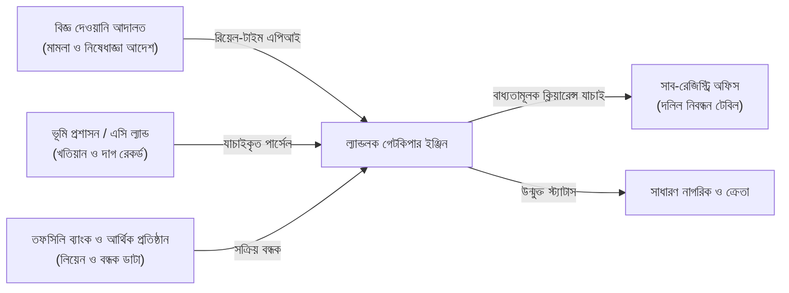
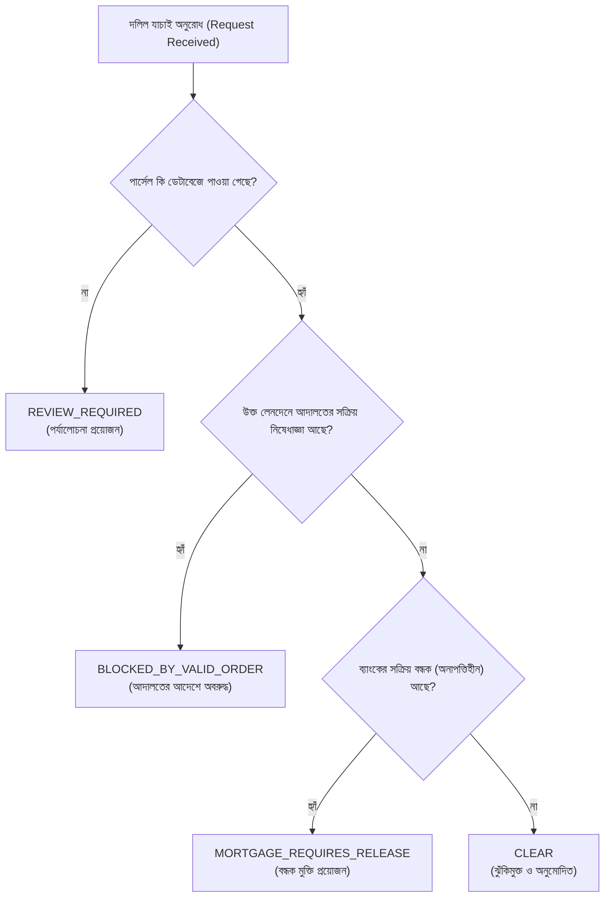

# ল্যান্ডলক ইঞ্জিন (LandLock Engine)
## স্বয়ংক্রিয় ভূমি নিষেধাজ্ঞা ও দলিল বোঝাই কেন্দ্রীয় রেজিস্ট্রি
### পূর্ণাঙ্গ টেকনিক্যাল ও ফাংশনাল প্রকল্প ডকুমেন্টেশন (Project Whitepaper & Documentation)

---

## ১. নির্বাহী সারসংক্ষেপ (Executive Summary)

**ল্যান্ডলক ইঞ্জিন (LandLock Engine)** হলো একটি অত্যাধুনিক, আন্তঃপ্রাতিষ্ঠানিক এবং স্বয়ংক্রিয় ভূমি লেনদেন সুরক্ষা প্লাটফর্ম। এর মূল উদ্দেশ্য হলো বাংলাদেশে ভূমি সংক্রান্ত দেওয়ানি আদালতের স্থগিতাদেশ/নিষেধাজ্ঞা, আর্থিক প্রতিষ্ঠানের বন্ধক (Mortgage/Lien) এবং ভূমি প্রশাসনের রেকর্ডসমূহকে একটি কেন্দ্রীয় ডিজিটাল গেটকিপার ইঞ্জিনের অধীনে এনে **সাব-রেজিস্ট্রি অফিসে দলিল নিবন্ধনের পূর্বেই অবৈধ, বিরোধপূর্ণ ও অবরুদ্ধ হস্তান্তর তাৎক্ষণিকভাবে বন্ধ করা**।

বর্তমানে আদালতের নিষেধাজ্ঞা বা ব্যাংকের বন্ধকের তথ্য সাব-রেজিস্ট্রারের টেবিলে যথাসময়ে পৌঁছায় না। এই কাঠামোগত দুর্বলতার সুযোগ নিয়ে অসাধু চক্র একই জমি একাধিক ব্যক্তির কাছে বিক্রি করে, ব্যাংকে বন্ধক রেখে আবার গোপনে রেজিস্ট্রি করে দেয় অথবা আদালতের মামলাধীন জমি জাল দলিলের মাধ্যমে হস্তান্তর করে। ল্যান্ডলক ইঞ্জিন এই বিচ্ছিন্ন প্রতিষ্ঠানগুলোর মধ্যে একটি রিয়েল-টাইম এপিআই গেটকিপার হিসেবে কাজ করে প্রতিটি দলিল নিবন্ধনের পূর্বে বাধ্যতামূলক ডিজিটাল অনাপত্তি (Pre-Registration Clearance) যাচাই করে।



---

## ২. সমস্যা ও পটভূমি (Problem Statement)

বাংলাদেশে জমি সংক্রান্ত বিরোধ ও মামলার হার বিশ্বের মধ্যে অন্যতম শীর্ষস্থানীয়:
1. **তথ্য আদান-প্রদানের সমন্বয়হীনতা:** দেওয়ানি আদালত যখন কোনো জমির ওপর নিষেধাজ্ঞা (Injunction/Status Quo) জারি করে, তখন আদালতের সেই কাগজের আদেশ ডাকযোগে বা পিয়ন মারফত ভূমি অফিস বা সাব-রেজিস্ট্রি অফিসে পৌঁছাতে কয়েক সপ্তাহ থেকে কয়েক মাস লেগে যায়। এই অন্তর্বর্তী সময়ে বিতর্কিত জমি বিক্রি হয়ে যায়।
2. **একই জমি বারবার বিক্রি ও একাধিক বন্ধক:** ব্যাংকে জমি মর্টগেজ রেখে ঋণ নেওয়ার পর মূল দলিলের দ্বিতীয় নকল বা ভুয়া খতিয়ান তৈরি করে সাধারণ ক্রেতার কাছে বিক্রি করে দেওয়া হয়।
3. **দ্বৈত মালিকানা ও অপরিকল্পিত জরিপ নম্বর:** শুধু একটি দাগ নম্বর দিয়ে জমি চিহ্নিত করার ফলে একই উপজেলার একাধিক মৌজায় অভিন্ন দাগ নম্বরের জটিলতা তৈরি হয়।
4. **ক্রেতা সাধারণের অসহায়ত্ব:** সাধারণ মানুষ জমি কেনার আগে জানার কোনো সহজ উপায় পান না যে জমিটিতে আদালতে কোনো মামলা চলছে কি না বা ব্যাংকে লিয়েন রয়েছে কি না।

---

## ৩. ল্যান্ডলক সমাধানের মূল স্তম্ভসমূহ (Core Architecture)

ল্যান্ডলক ইঞ্জিন ৩টি প্রধান স্তম্ভের ওপর প্রতিষ্ঠিত:

### ৩.১ সমন্বিত কম্পোজিট পার্সেল আইডেন্টিফায়ার (Composite Land Identifier)
শুধুমাত্র একক দাগ নম্বরের ওপর নির্ভর না করে ল্যান্ডলক প্রতিটি জমিকে একটি পূর্ণাঙ্গ হায়ারার্কিকাল আইডেন্টিফায়ারে রূপান্তর করে:
* **বিভাগ (Division):** ঢাকা (DHAKA)
* **জেলা (District):** ঢাকা (DHAKA)
* **উপজেলা (Upazila):** ধানমন্ডি (DHANMONDI)
* **মৌজা ও জেএল (Mouza & JL):** ধানমন্ডি-০১, জেএল ১০
* **খতিয়ান টাইপ ও নম্বর:** আরএস খতিয়ান ১০১
* **দাগ নম্বর:** ৫০০১
* **সাব-পার্সেল রেফারেন্স:** PL-1

এর ফলে বাংলাদেশের যেকোনো প্রান্তের যেকোনো জমিকে নির্ভুল ও এককভাবে (Globally Unique) শনাক্ত করা সম্ভব।

---

### ৩.২ পাঁচ-স্তরের স্বয়ংক্রিয় গেটকিপার ডিসিশন অ্যালগরিদম (5-Tier Decision Logic)

সাব-রেজিস্ট্রি অফিসে যখন কোনো দলিলের দলিলপত্র যাচাইয়ের জন্য সিস্টেমে পাঠানো হয়, তখন ল্যান্ডলক ইঞ্জিন কঠোর অগ্রাধিকারে নিচের ক্রমানুসারে সিদ্ধান্ত গ্রহণ করে:



| সিদ্ধান্ত কোড | আইনি অর্থ | সাব-রেজিস্ট্রারের করণীয় |
| :--- | :--- | :--- |
| **`BLOCKED_BY_VALID_ORDER`** | বিজ্ঞ আদালতের বৈধ নিষেধাজ্ঞা বলবৎ রয়েছে। | **রেজিস্ট্রি আইনত সম্পূর্ণ নিষিদ্ধ।** সিস্টেম দলিল সাবমিশন লক করে দেবে। |
| **`MORTGAGE_REQUIRES_RELEASE`** | ব্যাংকে বন্ধক বিদ্যমান এবং কোনো বৈধ দায়মুক্তি দলিল (Release Deed / NOC) দাখিল হয়নি। | রেজিস্ট্রি স্থগিত থাকবে যতক্ষণ না ব্যাংক থেকে ডিজিটাল অনাপত্তি আসে। |
| **`REVIEW_REQUIRED`** | পার্সেলের তফসিলে অস্পষ্টতা বা সীমানা বিরোধ সংক্রান্ত তথ্য যাচাইাধীন। | এসি ল্যান্ড ও রেকর্ড রুমের ম্যানুয়াল রিভিউ আবশ্যক। |
| **`CLEAR`** | কোনো নিষেধাজ্ঞা বা অপরিশোধিত বন্ধক নেই। | **দলিল নিবন্ধন প্রক্রিয়া সম্পন্ন করা যাবে।** |
| **`SYSTEM_UNAVAILABLE`** | জরুরি নেটওয়ার্ক ত্রুটি বা অপর্যাপ্ত অনুমোদন। | সাময়িক স্থগিতাদেশ ও সুরক্ষা অ্যালার্ট। |

---

### ৩.৩ টু-পার্টি মেকার-চেকার রুল (Two-Party Separation of Duty)
আইনি আদেশের অপব্যবহার রোধ করতে সিস্টেমে কঠোর সেপারেশন অব ডিউটি নিশ্চিত করা হয়েছে:
* **আদালত ক্লার্ক (`court_officer1`):** আদালতের মামলার বিবরণী ও আদেশের খসড়া (DRAFT) সিস্টেমে নথিভুক্ত করবেন এবং দাখিল (SUBMIT) করবেন। কিন্তু তিনি নিজে অনুমোদন করতে পারবেন না।
* **বিজ্ঞ বিচারক / অনুমোদনকারী (`order_approver1`):** আদেশের ফাইল ও নথি পর্যালোচনা করে ডিজিটাল অনুমোদন (APPROVE) বা প্রত্যাখ্যান (REJECT) করবেন।
* **স্বয়ংক্রিয় ফল:** বিচারকের অনুমোদনের সাথে সাথে ফ্র্যাকশন অব সেকেন্ডে সংশ্লিষ্ট পার্সেলে সক্রিয় নিষেধাজ্ঞা (`ACTIVE Restriction`) বসে যাবে এবং রেজিস্ট্রি গেটকিপার সেই জমির দলিল বিক্রি বন্ধ করে দেবে।

---

## ৪. সিস্টেম মডিউল ও ব্যবহারকারী ভূমিকা (Role-Based Modules)

| ভূমিকা (Role) | অনুমোদিত কার্যক্রম | সংশ্লিষ্ট পেইজ |
| :--- | :--- | :--- |
| **সিস্টেম প্রশাসক (`SYSTEM_ADMIN`)** | পূর্ণাঙ্গ সিস্টেম মনিটরিং, ব্যবহারকারী ব্যবস্থাপনা, সিস্টেম সেটিংস। | `/dashboard`, `/audit`, সকল মডিউল |
| **আদালত কর্মকর্তা (`COURT_OFFICER`)** | দেওয়ানি মামলা এন্ট্রি, দলিলের তফসিলে পার্সেল ট্যাগিং, খসড়া আদেশ দাখিল। | `/cases` |
| **আদেশ অনুমোদনকারী (`ORDER_APPROVER`)** | বিজ্ঞ জজ/ম্যাজিস্ট্রেট — আদেশের অনুমোদন ও বাতিলকরণ। | `/cases` |
| **ভূমি কর্মকর্তা (`LAND_OFFICER`)** | সহকারী কমিশনার (ভূমি) — খতিয়ান, মৌজা ও দাগ রেকর্ডের তথ্য হালনাগাদ। | `/parcels` |
| **রেজিস্ট্রি কর্মকর্তা (`REGISTRY_OFFICER`)** | সাব-রেজিস্ট্রার — দলিলের চূড়ান্ত স্বাক্ষরের পূর্বে গেটকিপার সিদ্ধান্ত যাচাই। | `/registry` |
| **ব্যাংক কর্মকর্তা (`BANK_OFFICER`)** | ঋণ বিতরণের পূর্বে জমির লিয়েন নিবন্ধন এবং ঋণ পরিশোধে অনাপত্তি/দায়মুক্তি প্রদান। | `/registry`, `/parcels/:id` |
| **অডিটর (`AUDITOR`)** | আদালতের নির্দেশ লঙ্ঘন করে কোনো চেষ্টা হয়েছে কি না তা পর্যবেক্ষণ ও নিরপেক্ষ নিরীক্ষা। | `/audit` |
| **নাগরিক (`CITIZEN`)** | সাধারণ নাগরিক — জমি কেনার পূর্বে পাবলিক স্ট্যাটাস ও আদালতের মামলার প্রাথমিক সত্যতা যাচাই। | `/citizen`, `/map` |

---

## ৫. মৌজা নকশা ও জিআইএস স্যাটেলাইট ভিউয়ার (GIS Cadastral Map)

ল্যান্ডলক ইঞ্জিনের অন্যতম যুগান্তকারী সংযোজন হলো **ক্যাডাস্ট্রাল মৌজা নকশা ও লাইভ স্যাটেলাইট ভিউয়ার (`/map`)**:
* **স্যাটেলাইট লেয়ার:** Esri World Imagery হাই-রেজোলিউশন স্যাটেলাইট টাইলের মাধ্যমে জমির প্রকৃত ভৌগোলিক অবস্থা দৃশ্যমান।
* **ভেক্টর ক্যাডাস্ট্রাল বাউন্ডারি:** নির্দিষ্ট দাগ নম্বরের সীমানা পলিগন আকারে মানচিত্রে অঙ্কিত থাকে।
* **কালার-কোডেড স্ট্যাটাস:**
  - 🔴 **লাল সীমানা:** আদালতের নিষেধাজ্ঞায় অবরুদ্ধ (দাগ ৫০০১, ধানমন্ডি)।
  - 🟡 **হলুদ সীমানা:** দেওয়ানি মামলা প্রক্রিয়াধীন (দাগ ৬০০২, গুলশান)।
  - 🟢 **সবুজ সীমানা:** সম্পূর্ণ দায়মুক্ত ও পরিষ্কার জমি (দাগ ৭০০৩, মিরপুর)।
* **ক্লিক-টু-ইনস্পেক্ট:** যেকোনো দাগে ক্লিক করলে তাৎক্ষণিকভাবে খতিয়ান, আয়তন, মালিকানা ও আদালতের আদেশের নম্বর পপ-আপে প্রদর্শিত হয়।

---

## ৬. প্রযুক্তিগত কাঠামো (Technology Stack)

```
                            ল্যান্ডলক ইঞ্জিন প্রযুক্তি স্ট্যাক
┌─────────────────────────────────────────────────────────────────────────────┐
│                             FRONTEND CLIENT                                  │
│   React 18  │  Vite 5  │  Tailwind CSS 3  │  React Query 5  │  Leaflet GIS  │
│          বাংলা ইউজার ইন্টারফেস (Hind Siliguri) + জাতীয় গভার্নমেন্ট থিম          │
└──────────────────────────────────────┬──────────────────────────────────────┘
                                       │
                         [রিয়েল-টাইম স্টেট ও ক্লায়েন্ট এপিআই]
                                       │
┌──────────────────────────────────────┴──────────────────────────────────────┐
│                             BACKEND ENGINE                                  │
│       Spring Boot 3.3  │  Java 21  │  Spring Security 6  │  JWT Auth        │
│          PostgreSQL 16  │  Flyway Migration  │  OpenAPI / Swagger 3         │
└─────────────────────────────────────────────────────────────────────────────┘
```

* **ফ্রন্টএন্ড টেকনোলজি:**
  - React 18 SPA আর্কিটেকচার।
  - Tailwind CSS (বাংলাদেশ সরকারের অফিশিয়াল প্যালেট: জাতীয় সবুজ `#006A4E`, লাল `#F42A41`, সোনালী `#FCD116`)।
  - Leaflet Map Engine ও Esri Satellite GIS টাইলিং।
  - Standalone In-Browser Mock Storage Engine (`localStorage` সিঙ্কড) যা অফলাইন/ডেমো শোকেসে কোনো ব্যাকএন্ড সার্ভার ছাড়াই ১০০% কার্যক্ষমতা প্রদর্শন করে।
* **ব্যাকএন্ড টেকনোলজি:**
  - Spring Boot 3.3.x (Java 21 LTS)।
  - Spring Data JPA, Hibernate, PostgreSQL।
  - Flyway ডেটাবেজ ভার্সনিং ও অটোমেটিক মাইগ্রেশন (V1 থেকে V6)।
  - JJWT বেয়ারার টোকেন ভিত্তিক অথেন্টিকেশন।
* **হোস্টিং ও ক্লাউড ডেপ্লয়মেন্ট:**
  - Hostinger CloudLinux/LiteSpeed ওয়েব সার্ভার।
  - Cloudflare CDN, Edge DNS ও SSL টার্মিনেশন।

---

## ৭. ডেমো ও শোকেস নির্দেশিকা (Step-by-Step Presentation Walkthrough)

মূল্যায়নকারী ও অতিথিদের সামনে প্রজেক্টটি ডেমো দেখানোর জন্য একটি আদর্শ দৃশ্যকল্প (Scenario) নিচে দেওয়া হলো:

### দৃশ্যকল্প: ধানমন্ডি মৌজার জমি নিয়ে বিরোধ ও রেজিস্ট্রি ব্লকিং

1. **ধাপ ১ (নাগরিক যাচাই):**
   - প্রথমে `/citizen` পেইজে যান। ডেমো বোতাম থেকে **"ধানমন্ডি দাগ ৫০০১"** নির্বাচন করুন।
   - ফলাফল দেখুন: 🛑 **আদালতে অবরুদ্ধ ও ব্যাংকে দায়বদ্ধ**। আদালতের আদেশ নম্বর `ORD-DH-2024-991` এবং ডেমো ব্যাংকের বন্ধক দেখা যাবে।
2. **ধাপ ২ (জিআইএস স্যাটেলাইট ম্যাপ প্রদর্শন):**
   - `/map` পেইজে যান। স্যাটেলাইট ভিউতে ধানমন্ডি ৫০০১ দাগের ওপর লাল পলিগন দেখতে পাবেন। ক্লিক করে বিস্তারিত পপ-আপ দেখুন।
3. **ধাপ ৩ (আদালতে নতুন আদেশ অনুমোদন):**
   - `/cases` পেইজে যান। গুলশান মৌজার মামলা `MS-2024-00456` নির্বাচন করুন।
   - খসড়া আদেশটি বিচারক হিসেবে **"আদেশ অনুমোদন করুন (Approve Order)"** বাটনে ক্লিক করুন।
   - সাথে সাথে আদেশের স্থিতি `APPROVED` হয়ে যাবে এবং গুলশান পার্সেলে স্বয়ংক্রিয় নিষেধাজ্ঞা বসে যাবে।
4. **ধাপ ৪ (সাব-রেজিস্ট্রি গেটকিপার সিদ্ধান্ত):**
   - `/registry` পেইজে যান। ধানমন্ডি পার্সেল ১ এবং লেনদেনের ধরন **"বিক্রয় (Sale Deed)"** সিলেক্ট করে **"সিদ্ধান্ত যাচাই করুন"** বাটনে ক্লিক করুন।
   - ফলাফল দেখুন: **`BLOCKED_BY_VALID_ORDER`** (রেজিস্ট্রি আইনত অবরুদ্ধ)।
   - এরপর মিরপুর পার্সেল ৩ নির্বাচন করে যাচাই করুন — ফলাফল আসবে: **`CLEAR`** (ঝুঁকিমুক্ত)।
5. **ধাপ ৫ (অপরিবর্তনীয় অডিট লগ):**
   - `/audit` পেইজে যান। প্রতিটি অ্যাকশন (কেস তৈরি, আদেশ অনুমোদন, গেটকিপার চেক) সময় এবং কর্মকর্তার নাম সহ নিরপেক্ষ ট্রেইলে সংরক্ষিত দেখতে পাবেন।

---

## ৮. ভবিষ্যৎ পরিকল্পনা ও জাতীয় বাস্তবায়ন (Future Roadmap)

1. **জাতীয় ভূমি সেবা (e-Mutation) এর সাথে API ইন্টিগ্রেশন:** ভূমি মন্ত্রণালয়ের নামজারি সিস্টেমের সাথে ওয়েবহুক সংযোগ।
2. **ডিজিটাল সাব-রেজিস্ট্রি সফটওয়্যার প্লাগইন:** সাব-রেজিস্ট্রারদের সফটওয়্যারে ল্যান্ডলক সিদ্ধান্ত 'CLEAR' না হওয়া পর্যন্ত দলিল জেনারেট বা পেমেন্ট গেটওয়ে বন্ধ থাকবে।
3. **বায়োমেট্রিক ও এনআইডি যাচাই:** জাতীয় পরিচয়পত্র ও বায়োমেট্রিক ফিঙ্গারপ্রিন্টের মাধ্যমে ক্রেতা-বিক্রেতার সরাসরি সম্পৃক্ততা নিশ্চিত করা।
4. **স্মার্ট ল্যান্ড কিউআর কোড (Smart Land Card):** প্রতিটি খতিয়ানের জন্য কিউআর কোড সম্বলিত স্মার্ট কার্ড যা স্ক্যান করলেই তাৎক্ষণিক আদালতের স্ট্যাটাস দেখা যাবে।

---
*ডকুমেন্ট প্রস্তুতকরণ: ল্যান্ডলক ইঞ্জিন কোর টিম*  
*তারিখ: ১৮ অক্টোবর ২০২৬*
